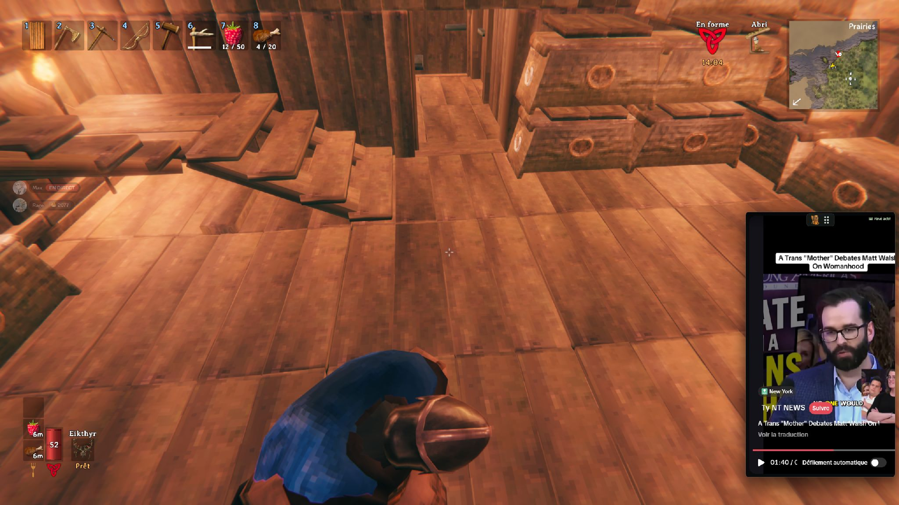

# BrainrotWhilePlaying

[English README](README.md) · [Contribuer](CONTRIBUTING.md) · [Licence MIT du code](LICENSE) · [Logo et éléments tiers](NOTICE.md)

Une seule fenêtre TikTok, sans bordure, toujours au-dessus du jeu. Les réglages apparaissent en surimpression avec **+** du pavé numérique. Ce panneau est une WebView locale distincte à l’intérieur de la même fenêtre ; TikTok ne peut pas invoquer ses commandes natives.



*Exemple en jeu : TikTok reste visible au-dessus de Valheim et se pilote au pavé numérique.*

## Lancer

Prérequis Windows : Node.js, Rust MSVC, Visual Studio Build Tools (C++ et Windows SDK), Microsoft Edge WebView2 Runtime.

```powershell
npm install
npm run dev
```

`npm run build:debug` produit `src-tauri/target/debug/brainrotwhileplaying.exe`. `npm run build` produit la version release dans `src-tauri/target/release/brainrotwhileplaying.exe`.

## Pavé numérique

Active Verr Num. Les raccourcis restent actifs même quand le jeu ou une autre application est au premier plan : tu peux parcourir TikTok sans quitter ton jeu. **/** bascule entre interaction avec la fenêtre et mode jeu avec clics traversants ; il ne désactive pas les commandes vidéo.

L’icône clavier affiche **Pavé actif** quand les commandes sont écoutées et **Saisie…** pendant le choix d’une nouvelle touche. Cet indicateur reste visible sur la vidéo lorsque le panneau est fermé.

| Touche | Action |
| --- | --- |
| + | Afficher / masquer les réglages |
| / | Interaction avec la fenêtre / mode jeu avec clics traversants |
| 0 | Afficher / masquer la fenêtre |
| 8 / 2 | Remonter / descendre dans le fil |
| 5 | Lecture / pause |
| 4 / 6 | Volume − / + |
| Décimal | Muet |
| 7 | Passer au coin suivant de l’écran |
| 9 | Alterner entre trois tailles |
| − | Vue compacte / site TikTok complet |
| * | Quitter |

Au lancement, **+** referme les réglages. **/** permet d’interagir avec TikTok ; un nouvel appui rend les clics au jeu et essaie de rendre le focus à la fenêtre précédente. Le pavé numérique continue de piloter TikTok dans les deux cas. **+** ouvre directement les réglages en mode interaction. Utilise un jeu en plein écran sans bordures.

En mode interaction, glisse la poignée **⠿** en haut de la vidéo pour déplacer librement la fenêtre. Lorsque les réglages sont ouverts, le nom **BrainrotWhilePlaying** sert aussi de poignée. Le déplacement à la souris est désactivé en mode jeu pour laisser les clics traverser la fenêtre. **9** change la taille en conservant la position choisie ; **7** replace volontairement la fenêtre dans un coin.

## Changer les raccourcis

Ouvre le panneau avec **+**, clique sur le raccourci d’une action et appuie sur la nouvelle touche (ou combinaison). Relâche la touche pour terminer. **Échap**, le bouton Annuler, une perte de focus ou 30 secondes sans saisie annulent la capture. Les raccourcis globaux sont suspendus pendant cette saisie. Clique sur **Enregistrer** pour les appliquer et les conserver au prochain lancement. Tous les raccourcis du tableau sont modifiables, y compris l’ouverture du panneau et la bascule du mode interaction.

Les doublons, touches non reconnues et conflits avec d’autres applications sont refusés. Un échec restaure les raccourcis précédents. **Réinitialiser** prépare les touches par défaut ; **Enregistrer** confirme ce choix. Le fichier est stocké dans le dossier de configuration utilisateur de BrainrotWhilePlaying, sous `keybinds.json`. Sous Windows, Entrée principale et Entrée du pavé partagent le même code natif et ne peuvent pas recevoir deux actions distinctes.

Pour te connecter ou accéder aux menus TikTok, affiche le site complet avec **−**, puis utilise **/** si nécessaire pour récupérer la souris. Les chiffres de la rangée principale permettent de remplir les formulaires sans déclencher les raccourcis du pavé. La session WebView2 est conservée localement entre les lancements.

## Limites et validation

La mise en page compacte et les commandes dépendent du site TikTok. **−** permet de retrouver la page normale si la mise en page du site change. La vidéo garde son format ; des bandes noires peuvent rester autour du contenu. Le logo de l’application utilise un fond transparent.

Pas d’injection dans le jeu ni de hook clavier bas niveau. Certains jeux peuvent recevoir également les touches du pavé ; le plein écran exclusif et le retour de focus dépendent de Windows et du jeu. Masquer ne met pas en pause. Les raccourcis sont sauvegardés ; taille, coin et mode ne le sont pas.

`npm test` couvre les commandes du lecteur avec un DOM simulé (Shadow DOM, boutons français et défilement compris). `cargo test --manifest-path src-tauri/Cargo.toml` vérifie la validation des raccourcis. `cargo clippy --manifest-path src-tauri/Cargo.toml -- -D warnings` vérifie le backend. Le fonctionnement dans chaque jeu reste à valider sur place.
