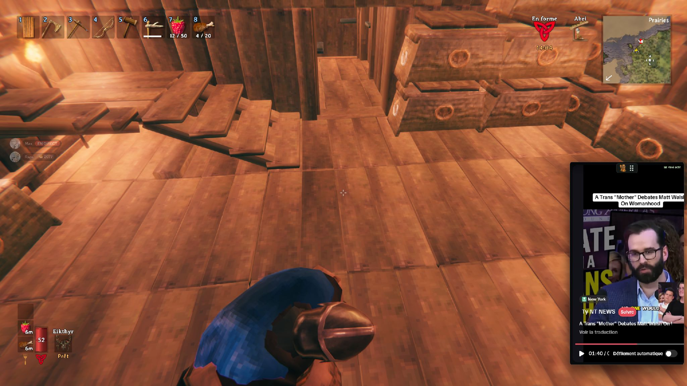

<p align="center">
  
</p>

# BrainrotWhilePlaying

[](https://github.com/Soif2Sang/brainrotwhileplaying/actions/workflows/ci.yml)
[](LICENSE)

Keep TikTok on screen while you play, and control it with your numpad.
A single always-on-top Windows window, with a built-in settings overlay.

**Windows prototype · Tauri 2 + Rust + WebView2 · [Guide en français](README.fr.md)**



*In-game example: TikTok stays above Valheim and can be controlled with the numpad.*

## Features

- Global shortcuts: scroll, play/pause, mute, and adjust volume while the game has focus.
- Game mode with click-through input, and interaction mode for using TikTok normally.
- An overlay to edit and save every shortcut, including the overlay and focus keys.
- A draggable window, four corner positions, and three sizes.
- A compact TikTok view with a toggle to restore the full website for login and menus.
- A transparent mascot icon in the overlay and Windows taskbar.

## Run from source

Use Windows with:

- Node.js 22 or newer (CI uses Node.js 24).
- Stable Rust with the MSVC toolchain, `rustfmt`, and `clippy`.
- Visual Studio Build Tools with **Desktop development with C++** and a Windows SDK.
- Microsoft Edge WebView2 Runtime.

See the [official Tauri Windows prerequisites](https://v2.tauri.app/start/prerequisites/#windows)
for setup instructions.

```powershell
git clone https://github.com/Soif2Sang/brainrotwhileplaying.git
cd brainrotwhileplaying
npm ci
npm run dev
```

This project supports Windows only. It uses Tauri's experimental `unstable`
multi-WebView API for the local settings overlay inside the same native window.

## Build a portable executable

```powershell
npm run build
```

The executable is written to `src-tauri/target/release/brainrotwhileplaying.exe`.
For a faster development build, run `npm run build:debug` and use the executable
in `src-tauri/target/debug/`.

The [Windows CI workflow](https://github.com/Soif2Sang/brainrotwhileplaying/actions/workflows/ci.yml)
also builds an unsigned executable and uploads it with the license notices as
the `BrainrotWhilePlaying-windows-x64` artifact. These are development builds,
not signed production releases. WebView2 must be installed separately.

## Default controls

Enable **Num Lock**. Shortcuts stay active while the game or another application
has focus; interaction mode does not disable video commands.

| Numpad key | Action |
| --- | --- |
| `+` | Show / hide settings |
| `/` | Switch between interaction and game mode |
| `0` | Show / hide the window |
| `8` / `2` | Previous / next video, or scroll up / down |
| `5` | Play / pause |
| `4` / `6` | Volume down / up |
| Decimal | Mute / unmute |
| `7` | Move to the next screen corner |
| `9` | Cycle through window sizes |
| `−` | Toggle compact / full TikTok view |
| `*` | Quit |

Use **borderless fullscreen** in your game. Exclusive fullscreen is not guaranteed
to display a normal always-on-top window.

Press `/` to interact with TikTok. Drag the **⠿** handle above the video to move the
window freely, or drag the app name while settings are open. Press `/` again to
let mouse clicks pass through to the game. The numpad still controls TikTok.

Press `+` to open settings, click a shortcut, press and release the new key or
combination, then click **Enregistrer** to save. **Réinitialiser** prepares the
defaults; save to apply them. Duplicate or unavailable shortcuts are rejected.
The current settings UI is in French.

## Data and security

The application has no backend service. It loads TikTok directly in WebView2;
TikTok's own network requests and cookies still apply. Login state stays in the
local WebView2 profile. Shortcuts are saved in the app's user configuration folder
as `keybinds.json`. The historical app identifier is `fr.padview.desktop`, retained
to preserve existing local profiles and settings.

Only the local settings WebView can call native app commands. The remote TikTok
WebView is not granted native permissions. See [SECURITY.md](SECURITY.md) for reports.

## Known limitations

- TikTok can change its layout, video controls, login flow, and availability.
  Player commands and compact-view selectors may need updates.
- Some games also receive numpad input through their own input system. Avoid
  assigning the same keys to in-game actions. There is no game injection or
  low-level keyboard hook, and no anti-cheat compatibility guarantee.
- Hiding the window does not pause playback. TikTok can reset volume on the next video.
- Window position, size, and mode are not saved between launches; shortcuts are saved.
- Tests cover shortcut validation and a simulated player DOM. They do not verify
  TikTok's live site or every game's fullscreen and input behavior.

## Development checks

```powershell
npm test
cargo fmt --manifest-path src-tauri/Cargo.toml -- --check
cargo test --locked --manifest-path src-tauri/Cargo.toml
cargo clippy --locked --manifest-path src-tauri/Cargo.toml -- -D warnings
```

See [CONTRIBUTING.md](CONTRIBUTING.md) for the source layout and manual checks.
Bug reports and contributions in English or French are welcome.

## License and branding

The original code and documentation are [MIT licensed](LICENSE).
The AI-generated mascot inspired by Tung Tung Tung Sahur is documented separately
and is **excluded from the code license**. Third-party characters, trademarks,
TikTok content, and dependency licenses retain their own terms.
Read [NOTICE.md](NOTICE.md) before reusing or redistributing the artwork.

This is an independent project, not affiliated with TikTok or the mascot's creator.
